# Menu Bar Calendar

*[Po polsku niżej.](#po-polsku)*

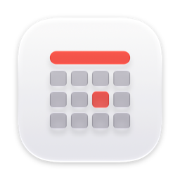

A calendar in the menu bar. Click the system's calendar icon at the top of the screen and a
panel opens with the same four views as Calendar: **Day**, **Week**, **Month** and **Year**.
The month shows week numbers and a dot under each day with an event, in the color of its
calendar; the week and the day list the events with their times. A click on a day opens it
in the day view, a week number opens that week, a month's name in the year opens that month;
while pressed, a day or week number gets the same circle as today's date. The next or
previous page slides in from its side.

**Open Calendar** at the bottom opens the calendar app you chose in Calendar → Settings →
General → Default calendar app. Pick Fantastical or another app there and the button opens
that one, with its name on it.

Everything follows the system: the language, the first day of the week, the date and time
format, light and dark appearance, the accent color. The words Day, Week, Today and No Events
are taken from Calendar itself, so they read exactly as in Calendar. In Finder and the menu bar
the app is named in the system's language: "Menu Bar Calendar", "Kalendarz na pasku menu",
"Menüleisten-Kalender"…

  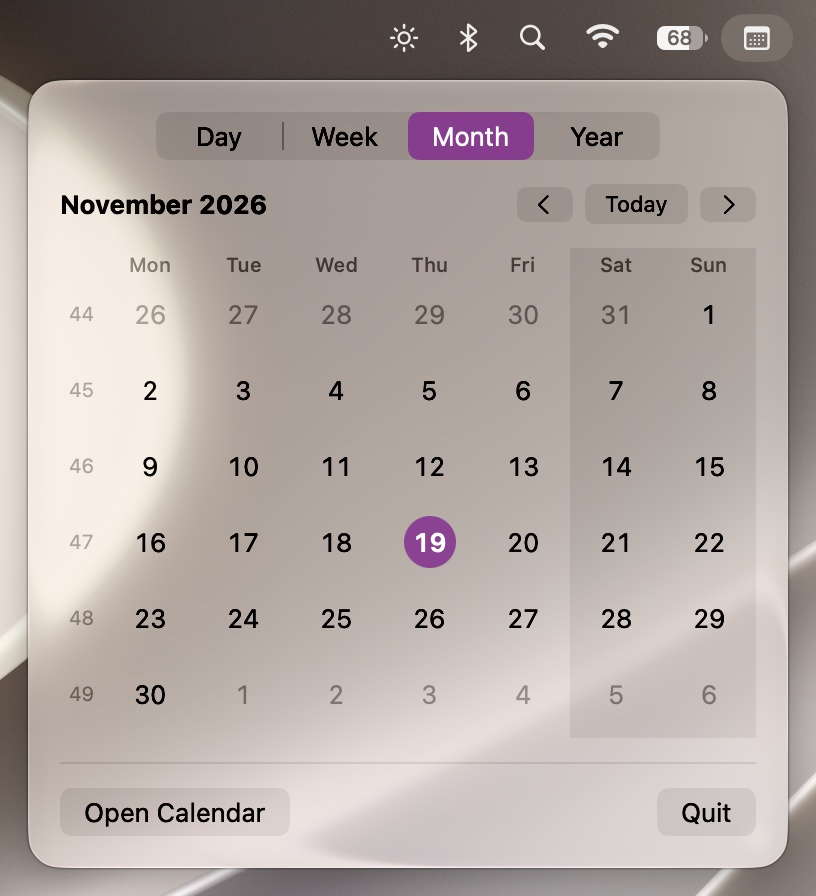
  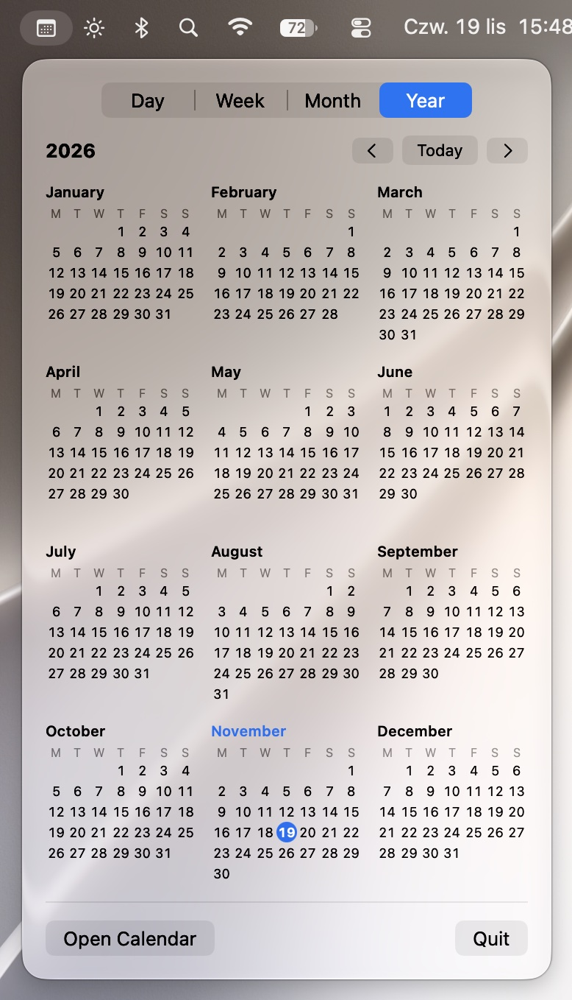
  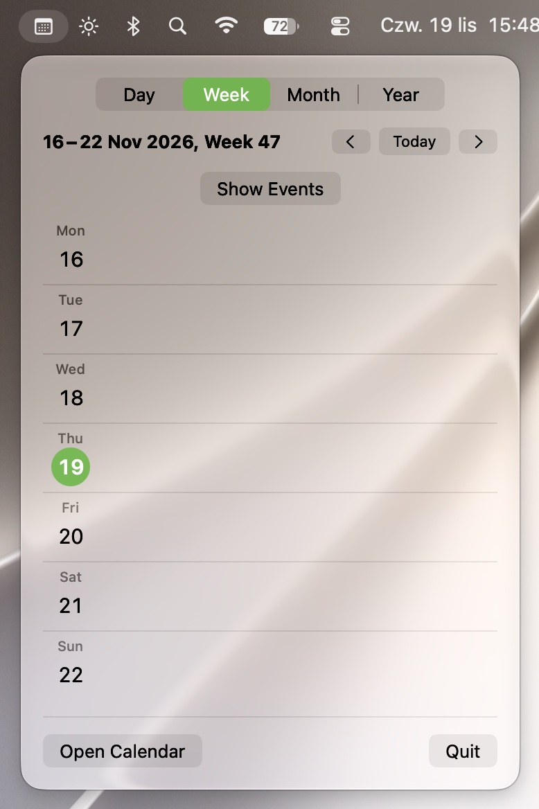
  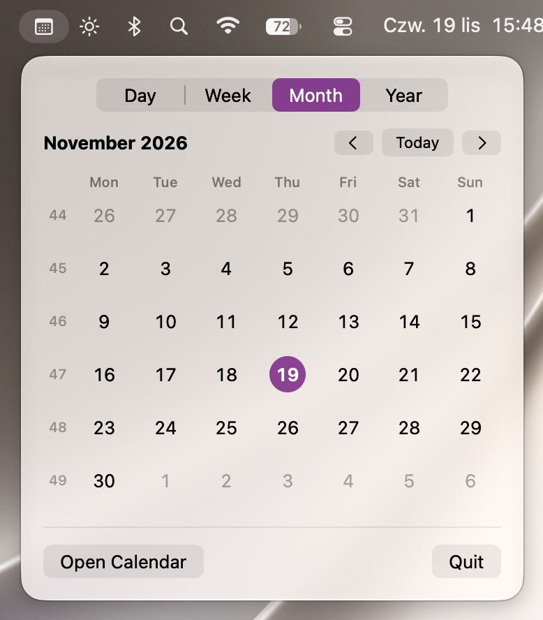

  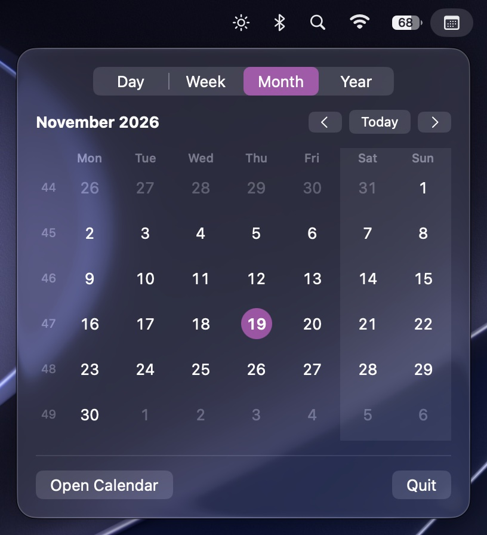
  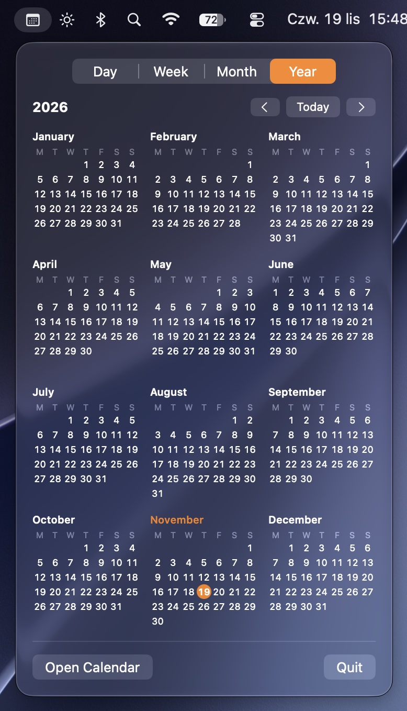
  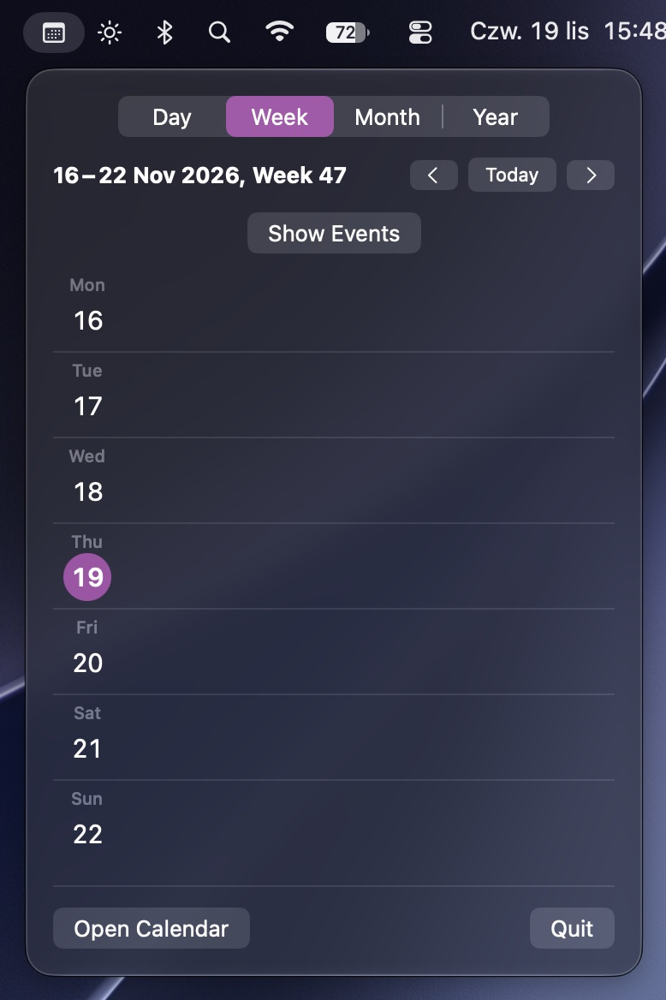

*The look follows System Settings → Appearance: light and dark, the accent color and the Liquid
Glass slider.*

Tested on a MacBook Air with M5, macOS 27.

## Install

1. Download [Menu-Bar-Calendar.zip](https://github.com/EnderNoch/Menu-Bar-Calendar/releases/latest/download/Menu-Bar-Calendar.zip)
   and unzip it (double-click).
2. Drag `Menu Bar Calendar.app` into Applications and open it. A calendar icon appears in the
   menu bar. There is no window and no Dock icon.
3. First launch: the app is signed ad hoc, not by Apple, so macOS blocks it. Open System
   Settings → Privacy & Security, scroll down, click "Open Anyway" next to the app and confirm.
   After that it opens normally.

Requires macOS 26 or later on a Mac with Apple silicon.

## Good to know

- **Events need your permission once.** Until then the calendar shows dates only. Click
  **Show Events** in the week or day view and macOS asks; after a No, the same button opens
  System Settings → Privacy & Security → Calendars. The app only reads the events, it never
  changes them or sends them anywhere.
- **Keys as in Calendar.** ← and → go back and forward, `⌘ + T` goes to today, `⌘ + 1` to
  `⌘ + 4` switch between Day, Week, Month and Year.
- **Calendar's settings apply here too.** Start week on, Days per week, Show week numbers (in
  the month and in the year, where a click opens that week), Show events in year view (here a
  dot under each day with events) and Turn on time zone support (with the zone chosen in
  Calendar) are read from Calendar → Settings each time the panel opens; the app has no
  switches of its own. Invitations you declined stay hidden, as in Calendar. Saturday and
  Sunday sit on a shaded band, as in Calendar's week and month views.
- **It opens on today.** Each time the panel opens it starts at today, in the view you used
  last.
- **Opens at login.** It adds itself on the first launch. Switch it off in System Settings →
  General → Login Items, and it stays off.
- **Hiding the icon** is System Settings → Menu Bar's job; the icon keeps its place.

## License

All rights reserved — see [LICENSE](LICENSE). You may download the finished app and use it on
your own computer. This is not open source: copying the code, distributing it other than by a
link to this repository, modifying it and training AI models on it require the author's
written permission.

Made by [EnderNoch](https://github.com/EnderNoch) (Atypical Maker) · part of
[Atypical Maker Mac Apps](https://github.com/EnderNoch/Atypical-Maker-Mac-Apps).

---

## Po polsku

Kalendarz na pasku menu. Kliknij systemową ikonę kalendarza u góry ekranu, a otworzy się panel
z tymi samymi czterema widokami co w Kalendarzu: **Dzień**, **Tydzień**, **Miesiąc** i
**Rok**. Miesiąc pokazuje numery tygodni i kropkę pod każdym dniem z wydarzeniem, w kolorze
jego kalendarza; tydzień i dzień wypisują wydarzenia z godzinami. Kliknięcie dnia otwiera go
w widoku dnia, numer tygodnia otwiera ten tydzień, a nazwa miesiąca w widoku roku ten miesiąc;
w chwili kliknięcia dzień albo numer tygodnia dostaje takie samo kółko jak dzisiejsza data.
Następna albo poprzednia strona wsuwa się ze swojej strony.

**Otwórz Kalendarz** na dole otwiera aplikację kalendarza wybraną w Kalendarz → Ustawienia →
Ogólne → Domyślna aplikacja kalendarza. Wybierz tam Fantastical albo inną aplikację, a przycisk
otworzy właśnie ją i pokaże jej nazwę.

Wszystko idzie za systemem: język, pierwszy dzień tygodnia, format daty i godziny, jasny
i ciemny wygląd, kolor akcentu. Słowa Dzień, Tydzień, Dzisiaj i Brak wydarzeń są brane z samego
Kalendarza, więc brzmią dokładnie jak w nim. W Finderze i na pasku menu aplikacja nazywa się
w języku systemu: „Kalendarz na pasku menu”, „Menu Bar Calendar”, „Menüleisten-Kalender”…

  
  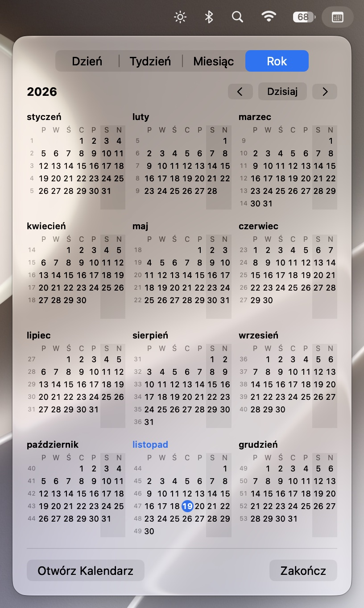
  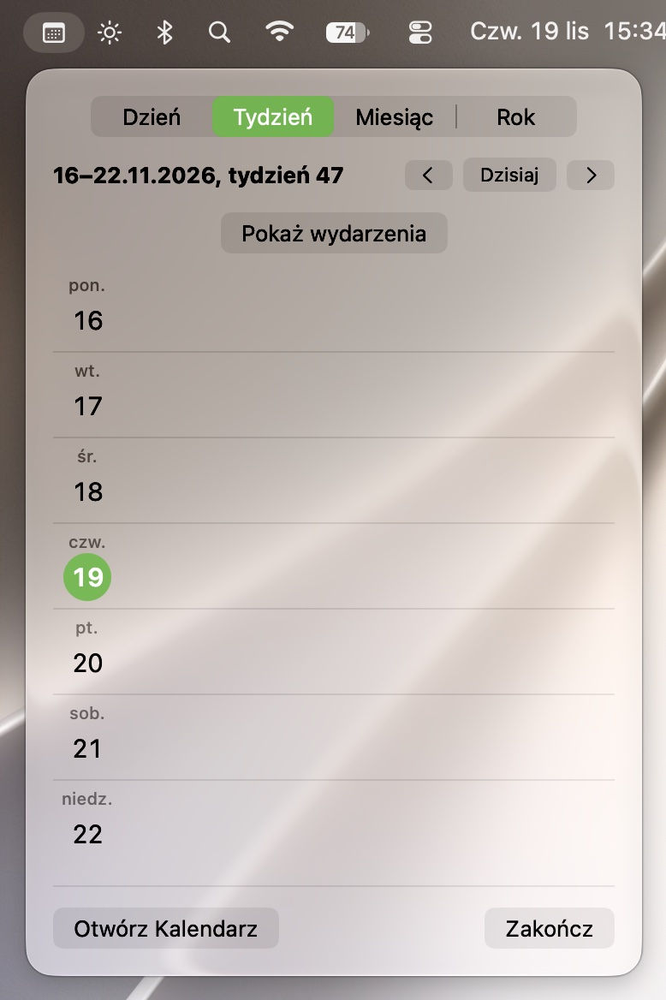
  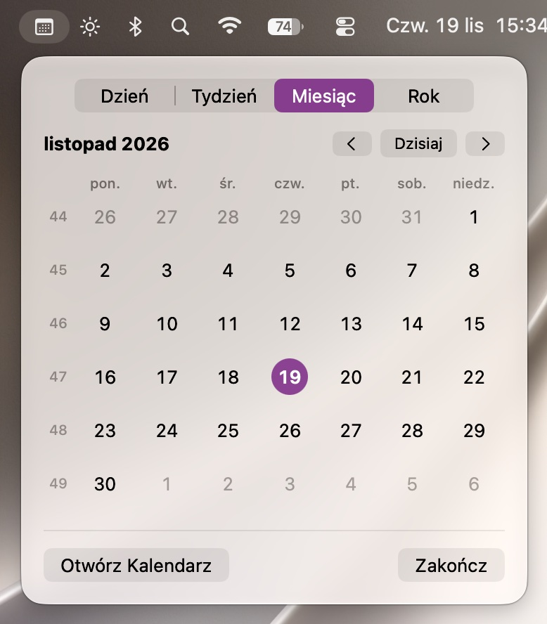

  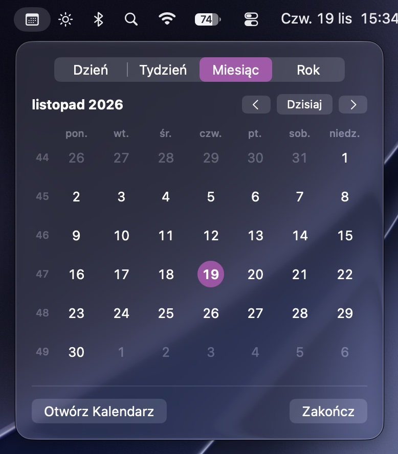
  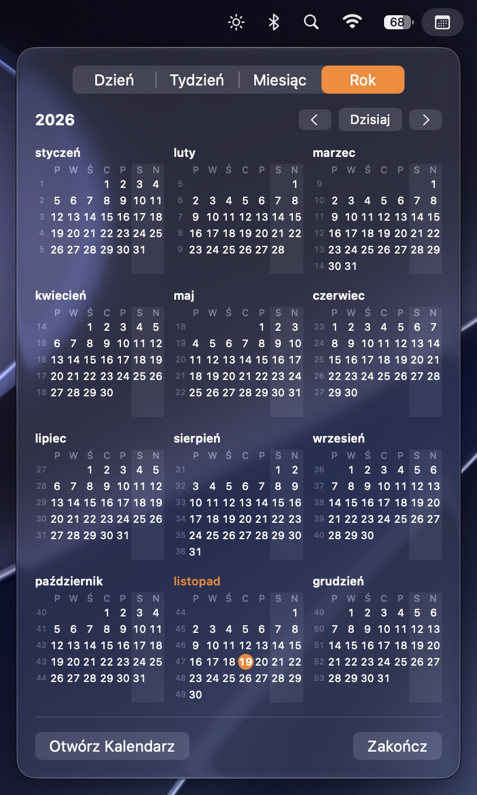
  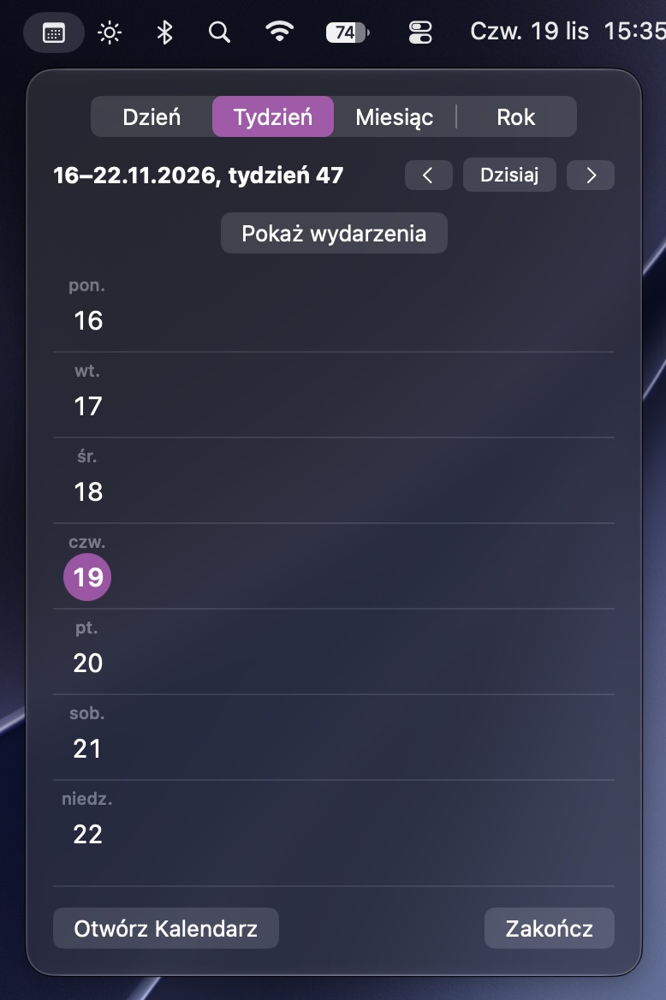

*Wygląd idzie za Ustawieniami systemowymi → Wygląd: jasny i ciemny, kolor akcentu i suwak
Liquid Glass.*

Testowane na MacBooku Air z M5, macOS 27.

### Instalacja

1. Pobierz [Menu-Bar-Calendar.zip](https://github.com/EnderNoch/Menu-Bar-Calendar/releases/latest/download/Menu-Bar-Calendar.zip)
   i rozpakuj go (dwuklik).
2. Przeciągnij `Menu Bar Calendar.app` do folderu Aplikacje i otwórz. Na pasku menu pojawi się
   ikona kalendarza. Nie ma okna ani ikony w Docku.
3. Pierwsze uruchomienie: aplikacja jest podpisana ad-hoc, nie przez Apple, więc macOS ją
   zablokuje. Otwórz Ustawienia → Prywatność i ochrona, przewiń w dół i kliknij „Otwórz mimo
   to” przy aplikacji, potem potwierdź. Później otwiera się już normalnie.

Wymaga macOS 26 lub nowszego i Maca z procesorem Apple.

### Dobrze wiedzieć

- **Wydarzenia wymagają jednej zgody.** Do tego czasu kalendarz pokazuje same daty. Kliknij
  **Pokaż wydarzenia** w widoku tygodnia albo dnia, a macOS zapyta; po odmowie ten sam przycisk
  otwiera Ustawienia → Prywatność i ochrona → Kalendarze. Aplikacja tylko czyta wydarzenia,
  niczego nie zmienia ani nigdzie nie wysyła.
- **Klawisze jak w Kalendarzu.** ← i → przechodzą wstecz i dalej, `⌘ + T` wraca do dzisiaj,
  `⌘ + 1` do `⌘ + 4` przełączają Dzień, Tydzień, Miesiąc i Rok.
- **Ustawienia Kalendarza działają też tutaj.** Pierwszy dzień tygodnia, Dni w tygodniu,
  Pokazuj numery tygodni (w miesiącu i w roku, gdzie kliknięcie otwiera ten tydzień), Pokazuj
  wydarzenia w widoku roku (tu kropka pod każdym dniem z wydarzeniem) i Włącz obsługę stref
  czasowych (ze strefą wybraną w Kalendarzu) są czytane z Kalendarz → Ustawienia przy każdym
  otwarciu panelu; aplikacja nie ma własnych przełączników. Odrzucone zaproszenia są ukryte,
  jak w Kalendarzu. Sobota i niedziela leżą na przyciemnionym pasie, jak w widokach tygodnia
  i miesiąca w Kalendarzu.
- **Otwiera się na dzisiaj.** Za każdym otwarciem panel zaczyna od dzisiejszego dnia, w widoku
  używanym ostatnio.
- **Otwiera się przy logowaniu.** Dodaje się sama przy pierwszym uruchomieniu. Wyłączysz to
  w Ustawieniach → Ogólne → Rzeczy otwierane podczas logowania i już tak zostanie.
- **Ukrywanie ikony** to zadanie Ustawień → Pasek menu; ikona zachowuje swoje miejsce.
